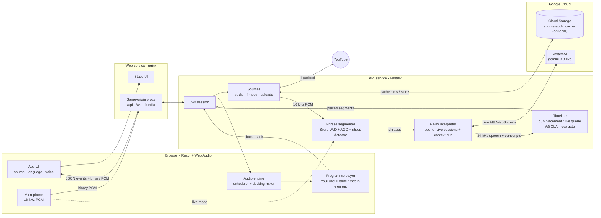
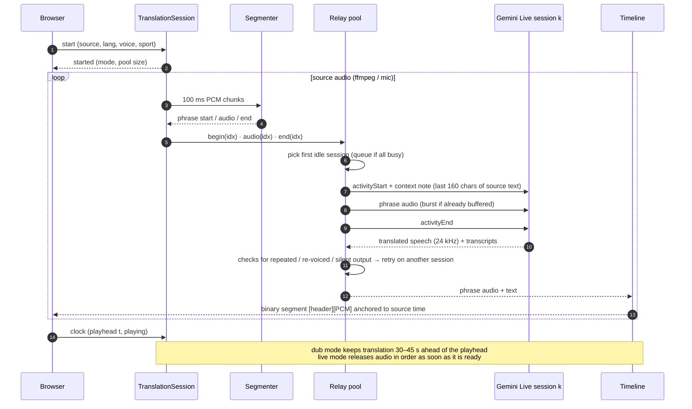
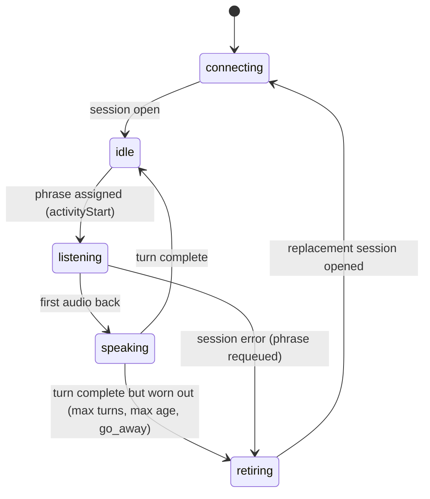
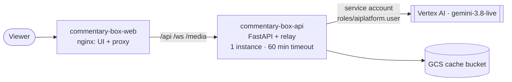

# Gemini Live Commentary Translation

Real-time, expressive translation of sports commentary. Pick a match clip, a YouTube video or live stream, an uploaded
file or your microphone, and choose one of 32 target languages: Hindi, Tamil, Telugu, Kannada, Malayalam, Marathi,
Gujarati, Bengali, Punjabi, Odia, Assamese, Urdu, Spanish, French, Japanese and more. You hear a single commentator
in that language, timed to the action, with the original broadcast ducked underneath.

The translator is **`gemini-3.8-live`** on Vertex AI, used speech-to-speech. There is no ASR → MT → TTS cascade, so the
model hears *how* the commentator speaks (the build-up, the shout on a six, the roar after a goal) and reproduces
that delivery, not just the words.

---

## Contents

- [Features](#features)
- [Architecture](#architecture)
  - [Why a relay of interpreters?](#why-a-relay-of-interpreters)
  - [System overview](#system-overview)
  - [Phrase lifecycle](#phrase-lifecycle)
  - [Relay session states](#relay-session-states)
  - [Components](#components)
  - [WebSocket protocol](#websocket-protocol)
- [Project layout](#project-layout)
- [Prerequisites](#prerequisites)
- [Install and run locally](#install-and-run-locally)
- [Using the app](#using-the-app)
- [Configuration](#configuration)
- [Deploy to Google Cloud Run](#deploy-to-google-cloud-run)
- [Development and tests](#development-and-tests)
- [Measured results](#measured-results)
- [Known limitations](#known-limitations)

---

## Features

- **Speech-to-speech with Gemini Live.** One system instruction and one voice for every phrase, with a per-language
  broadcast style (for example Hindi TV commentary keeps "विकेट", "बाउंड्री" and shouts "छक्का!").
- **Two modes.**
  - **Dub mode** (pre-recorded: library, YouTube VOD, uploads). Translation runs ahead of the video. Each translated
    phrase is placed where its source phrase starts, so pauses match the original.
  - **Live mode** (microphone, YouTube live streams). Audio plays as soon as it arrives, in order, with gentle catch-up.
- **Broadcast-grade segmentation.** A Silero VAD with AGC and a pitched-shout detector cuts phrases, so the loudest
  calls over crowd noise are kept.
- **Clean output.** Synthesized crowd roar is gated, phrases the model re-voices are retried, and overruns are
  time-compressed with pitch preserved (WSOLA).
- **Browser mixer.** The original is ducked under the translation (fast attack, slow release). Seeking restarts the
  translation, and a live "relay strip" shows which interpreter session voiced which phrase.
- **32 target languages**, all checked in [`backend/commentary/data/language_matrix.json`](backend/commentary/data/language_matrix.json).

---

## Architecture

### Why a relay of interpreters?

`gemini-3.8-live` is turn-based. It streams each answer at about 1× real time and **discards audio that arrives
while it is speaking**. Sports commentary never stops for the model to finish, so one long-lived session fed
continuous commentary dropped 7 of 10 phrases in testing, including the "SIX!" call.

The fix is a **relay**, the way human interpreters work in a booth. The source is cut into short phrases at natural
pauses, and each phrase goes to whichever Live session is idle. A pool of 4 sessions (live mode) or 6 sessions (dub
mode) handles continuous commentary with no dropped phrases. A shared *context bus* gives every session the most
recent source transcript, so a phrase like "That is gone" is translated in context (a big hit, not a wicket).

### System overview



In local development, FastAPI serves the built UI itself and nginx is not needed. On Cloud Run, the nginx service
gives the browser a single origin, so WebSockets and uploads need no CORS.

### Phrase lifecycle



### Relay session states

Each interpreter session ("booth") moves through these states. They are shown live in the UI's relay strip.



### Components

| Module | Responsibility |
|---|---|
| [`server.py`](backend/commentary/server.py) | FastAPI app: `/api/config`, `/api/youtube`, `/api/upload`, `/media/{id}`, the `/ws` session socket, and the built UI. |
| [`session.py`](backend/commentary/session.py) | One browser session. Picks dub or live mode, reads the source, routes phrases to the relay and the relay's output to the timeline, and keeps dub translation within 45 s of the playhead. |
| [`sources.py`](backend/commentary/sources.py) | YouTube metadata and audio via `yt-dlp`, uploads, `ffmpeg` decoding to 16 kHz mono PCM. Cache order: local disk → GCS bucket → YouTube. |
| [`segmenter.py`](backend/commentary/segmenter.py) | Cuts audio into 1.2–6 s phrases (1–3.5 s live) at pauses. Silero VAD (ONNX) behind AGC, plus a periodicity-based shout detector, because energy VADs and Silero both miss screamed calls over crowd noise. |
| [`relay.py`](backend/commentary/relay.py) | The relay interpreter. A pool of `gemini-3.8-live` sessions with manual activity detection, `NO_INTERRUPTION`, context-window compression, the 160-character context bus, repeat/re-voice/silence guards with retry, and self-recycling before session limits or on `go_away`. |
| [`prompts.py`](backend/commentary/prompts.py) | System instruction per target language and sport, with broadcast-style hints (register, loanwords, signature calls). |
| [`timeline.py`](backend/commentary/timeline.py) | `DubTimeline` places each phrase at its source start and compresses overruns up to 1.18×. `LiveTimeline` is a gapless queue that speeds up slightly when the listener falls behind. |
| [`audio.py`](backend/commentary/audio.py) | Streaming WSOLA time-compression, edge fades, and the **roar gate**, which attenuates stationary, weakly periodic output (≥ 500 ms) when the model imitates the crowd instead of speaking. |
| [`frontend/`](frontend/) | React + Vite UI. `audioEngine.ts` schedules segments against the programme clock and ducks the original. `players.ts` wraps the YouTube IFrame API and media elements. `mic.ts` captures 16 kHz PCM. |

### WebSocket protocol

The browser opens `/ws`. Control and events are JSON text frames. Audio is sent as binary frames.

| Direction | Message | Purpose |
|---|---|---|
| → server | `{"action":"start","source":{...},"lang":"hi-IN","voice":"Orus","sport":"auto","start_at":0}` | Start a session. `source.kind` is `youtube`, `file` or `mic` |
| → server | `{"action":"clock","t":12.3,"playing":true}` | Programme playhead (dub mode) |
| → server | `{"action":"seek","t":95}` / `{"action":"stop"}` | Restart from a new position / stop |
| → server | binary int16 PCM @ 16 kHz | Microphone audio (live mode) |
| ← client | `started`, `ready`, `status`, `error`, `slots`, `src_text`, `out_text`, `phrase_done`, `stats`, `source_done`, `stopped` | Session state, transcripts, relay strip, metrics |
| ← client | binary `[u32 LE header length][JSON header][int16 PCM @ 24 kHz]` | Translated audio. The header holds the placement (`start`, `src_start`, `rate`, `text`) |

Types are shared in [`frontend/src/lib/protocol.ts`](frontend/src/lib/protocol.ts).

---

## Project layout

```
.
├── backend/
│   ├── commentary/
│   │   ├── server.py         # FastAPI HTTP + WebSocket entry point
│   │   ├── session.py        # per-connection pipeline orchestration
│   │   ├── relay.py          # pool of Gemini Live interpreter sessions
│   │   ├── segmenter.py      # VAD + shout-aware phrase segmentation
│   │   ├── timeline.py       # dub placement and live queueing
│   │   ├── audio.py          # WSOLA, fades, roar gate
│   │   ├── sources.py        # yt-dlp, ffmpeg, uploads, GCS cache
│   │   ├── prompts.py        # system instructions and style hints
│   │   ├── config.py         # settings, languages, voices
│   │   ├── library.py        # curated demo clips
│   │   ├── data/             # language verification + voice selection results
│   │   └── models/           # silero_vad.onnx
│   ├── tests/                # unit tests (pytest)
│   └── Dockerfile            # API image
├── frontend/                 # React + Vite UI, nginx image for Cloud Run
├── tools/seed_cache.py       # pre-fill the GCS source-audio cache
├── cloudbuild.yaml           # builds api + web images
├── deploy.sh                 # Cloud Build + Cloud Run deploy
├── pyproject.toml / uv.lock  # Python dependencies (uv)
└── .env.example              # environment template
```

---

## Prerequisites

| Tool | Version | Why |
|---|---|---|
| Python | 3.12+ | backend |
| [uv](https://docs.astral.sh/uv/) | recent | Python environment and dependencies |
| Node.js | 22+ | builds the frontend; `yt-dlp` also uses it to solve YouTube's JS challenge |
| ffmpeg | any recent | decodes every source to PCM |
| Google Cloud project | — | with the **Vertex AI API** enabled and access to `gemini-3.8-live` in your region |
| gcloud CLI | — | for local auth and Cloud Run deploys |

macOS: `brew install uv node ffmpeg`. Debian/Ubuntu: `apt install ffmpeg nodejs`, then install uv with
`curl -LsSf https://astral.sh/uv/install.sh | sh`.

---

## Install and run locally

```bash
git clone https://github.com/kkrishnan90/Gemini-Live-Commentary-Translation.git
cd Gemini-Live-Commentary-Translation

# 1. Python dependencies (creates .venv)
uv sync

# 2. Frontend build (served by the backend from frontend/dist)
(cd frontend && npm install && npm run build)

# 3. Configure Google Cloud access
cp .env.example .env              # then set GOOGLE_CLOUD_PROJECT
gcloud auth application-default login
gcloud services enable aiplatform.googleapis.com --project YOUR_PROJECT_ID

# 4. Run
uv run uvicorn commentary.server:app --app-dir backend --port 8000
```

Open <http://localhost:8000>.

**Authentication.** Application Default Credentials (`gcloud auth application-default login`) is the simplest
option. To use a service-account key instead, save it as `credentials.json` in the repo root and uncomment
`GOOGLE_APPLICATION_CREDENTIALS` in `.env`. Both files are gitignored. The identity needs the
**Vertex AI User** role (`roles/aiplatform.user`).

**Frontend development.** Run `npm run dev` in `frontend/` (port 5173). Vite proxies `/api`, `/ws` and `/media` to
the backend on port 8000, with hot reload.

---

## Using the app

1. **Choose a source**
   - **Library**: curated clips (cricket, football, kabaddi, tennis, F1, basketball) in English, Hindi, Spanish and French.
   - **YouTube**: paste any video or live-stream link.
   - **Upload**: audio or video (`mp3`, `m4a`, `wav`, `ogg`, `webm`, `mp4`, `mov`, `mkv`, `flac`, …).
   - **Microphone**: live interpretation of whatever you say or play. Use headphones so the translation is not
     picked up by the mic.
2. **Choose the target language** and, optionally, the voice (default **Orus**, picked in a voice study) and the
   sport (default: auto-detect).
3. **Press play.** In dub mode the video waits for about 8 s of translated audio to buffer, then plays with the
   translation on top and the original ducked. Seeking restarts translation from the new position. In live mode
   translated speech starts about 3–4 s after each phrase begins.

The relay strip below the player shows each interpreter session's state and which phrase it is voicing.

---

## Configuration

Settings are read from `.env` (loaded with `override=True`, so it wins over shell exports) or from the environment.

| Variable | Default | Meaning |
|---|---|---|
| `GOOGLE_CLOUD_PROJECT` | — (required) | Project used for Vertex AI (and GCS, if enabled) |
| `GOOGLE_CLOUD_LOCATION` | `us-central1` | Must be a **region** where `gemini-3.8-live` is available, not `global` |
| `GOOGLE_GENAI_USE_VERTEXAI` | `true` | Route the `google-genai` SDK to Vertex AI |
| `GOOGLE_APPLICATION_CREDENTIALS` | unset | Optional path to a service-account key; ADC is used otherwise |
| `CACHE_BUCKET` | unset | Optional GCS bucket for the shared source-audio cache |
| `DEFAULT_VOICE` | `Orus` | Fallback voice if `data/voice_pick.json` is absent |

---

## Deploy to Google Cloud Run

The deployment runs two services, built by Cloud Build:



One-time setup (replace `PROJECT`):

```bash
export PROJECT=your-gcp-project-id REGION=us-central1
gcloud services enable run.googleapis.com cloudbuild.googleapis.com artifactregistry.googleapis.com \
  aiplatform.googleapis.com storage.googleapis.com --project $PROJECT
gcloud artifacts repositories create commentary-box --repository-format docker --location $REGION --project $PROJECT

# Runtime identity for the API: Vertex AI access only, no key files in the image
gcloud iam service-accounts create commentary-box-api --project $PROJECT
gcloud projects add-iam-policy-binding $PROJECT \
  --member "serviceAccount:commentary-box-api@$PROJECT.iam.gserviceaccount.com" --role roles/aiplatform.user

# Source-audio cache (deploy.sh expects <project>-commentary-box-cache)
gcloud storage buckets create gs://$PROJECT-commentary-box-cache --location $REGION --project $PROJECT
gcloud storage buckets add-iam-policy-binding gs://$PROJECT-commentary-box-cache \
  --member "serviceAccount:commentary-box-api@$PROJECT.iam.gserviceaccount.com" --role roles/storage.objectAdmin
```

Build and deploy:

```bash
PROJECT=your-gcp-project-id ./deploy.sh v1      # builds both images, deploys api, then web
```

Notes:

- The API runs as **one instance**, so uploads and the session that uses them share a disk. Its 60-minute request
  timeout keeps WebSockets open for a full match segment.
- **YouTube often bot-checks Cloud Run IP ranges.** Source audio is therefore looked up in order: local disk → GCS
  bucket → `yt-dlp`. Seed the bucket from a machine YouTube allows:
  `CACHE_BUCKET=your-cache-bucket uv run python tools/seed_cache.py [video ids]` (no ids = the whole library).
  If a link is blocked, the app says so and Upload is the fallback.
- `deploy.sh` makes both services public (`--allow-unauthenticated`), and every session spends Vertex AI quota.
  Remove that flag and put IAP or another auth layer in front for anything beyond a demo.
- Uploads are capped at 32 MB (Cloud Run's HTTP/1 request limit).

---

## Development and tests

```bash
uv run pytest                      # unit tests: segmenter, WSOLA, roar gate, timelines, prompts, relay guards
uv run ruff check backend tools    # lint
(cd frontend && npm run lint)      # oxlint
```

---

## Measured results

| Question | Result |
|---|---|
| Which target languages work? | 32/32 judged to be the correct spoken language, including gu, pa, kn, ml, or and as, which are not in the 3.8 docs ([`language_matrix.json`](backend/commentary/data/language_matrix.json)) |
| Which voice? | **Orus.** 16 male voices → 48 runs → top 5 → 27 runs across cricket/football and English/Spanish sources, scored on pitch range, presence, loudness dynamics, excitement tracking and a listening judge ([`voice_pick.json`](backend/commentary/data/voice_pick.json)) |
| Context bus size | 160 characters fixed the context errors; 360 characters doubled re-voiced duplicates |
| Roar gate | Caught all 8 synthesized-roar runs in the voice study, with 0 false positives |
| Dub sync | 26/26 phrases placed before their play time, start offset 0.12–0.44 s, 0 stalls in a 60 s browser soak |
| Live latency | Phrase start → translated speech start: median 3.9 s (p90 5.5 s) |
| Mix as heard (judge, /10) | expressiveness 8, mix 8, artifacts 8.5, sync 7, flow 6.5 |

---

## Known limitations

- **Live lag** is above a 2–3 s target when measured from phrase start (the delay a listener perceives per word is
  about 2.5–3 s). Shorter phrases cut lag but give the model less context.
- **Phrase-level turns** can reset delivery slightly between phrases (judge flow score 6.5 on a highlights package).
- **Voices:** `VoiceConfig.voice` (catalog or custom voices) is silently ignored by `gemini-3.8-live`. Only the 30
  core prebuilt voices work. The UI offers the 16 male ones.
- **YouTube:** downloading audio with `yt-dlp` may conflict with YouTube's Terms of Service. It is meant for
  evaluation only. From cloud IPs, arbitrary links work only when YouTube does not bot-check the request.
- **Library clips** are public YouTube uploads embedded through the IFrame player. Rights remain with their owners.
